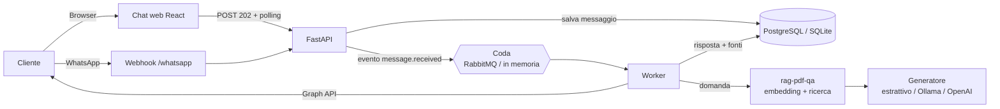

# Assistente NCC con RAG

[](https://github.com/dottssacarroneantonella-webDeveloper/assistente-ncc-rag/actions/workflows/ci.yml)


Assistente virtuale per un servizio **NCC / transfer** che risponde alle domande dei clienti
(tariffe, condizioni, disdette, bagagli, animali…) **usando solo i documenti dell'attività** e
citando le fonti. Il canale finale è **WhatsApp** (Meta Cloud API); per provarlo senza account
Meta c'è una **chat web in stile WhatsApp** che usa esattamente la stessa pipeline.

Il motore di ricerca sui documenti è la mia libreria
[rag-pdf-qa](https://github.com/dottssacarroneantonella-webDeveloper/rag-pdf-qa), usata qui come
dipendenza.

> L'attività "NCC Levante Transfer" e i suoi documenti sono **fittizi**: servono solo per la demo.

## Cosa fa

| Funzione | Stato |
|---|---|
| Chat web con risposte basate sui PDF e fonti citate (file e pagina) | ✅ F1 |
| Benvenuto con domande di esempio, saluti riconosciuti senza RAG | ✅ F1 |
| "Non lo so" onesto + domanda registrata per il titolare | ✅ F1 |
| Ritentativi automatici (3 tentativi, attesa 2/4/8 s) e messaggio di scuse | ✅ F1 |
| Comando `CANCELLA DATI` per eliminare la conversazione | ✅ F1 |
| Endpoint `/health` (database, coda, indice) | ✅ F1 |
| Webhook WhatsApp firmato, deduplica, RabbitMQ, worker separato | 🔜 F2 |
| Area admin: login, caricamento PDF, reindicizzazione, domande senza risposta | 🔜 F3 |
| GDPR (numeri cifrati con HMAC, conservazione 30 giorni) e hardening | 🔜 F4 |
| Demo online con deploy automatico | 🔜 F5 |

## Architettura



**Perché la coda?** Il webhook di WhatsApp deve rispondere in pochi secondi, mentre un LLM può
impiegarne di più. L'API salva il messaggio e risponde subito (`202 Accepted`); il worker elabora
con calma, ritenta se l'LLM non risponde e non perde messaggi.

**Scelte principali**

- **Coda astratta** (`MessageQueue`): RabbitMQ in produzione, coda in memoria per demo e test.
- **Generatore configurabile**: `extractive` (gratis, nessun LLM: restituisce le frasi più
  pertinenti dei documenti), `ollama` (LLM locale) oppure `openai`.
- **Reindicizzazione atomica**: il nuovo indice si costruisce in una cartella temporanea e
  sostituisce il vecchio con un rename, così nessuna domanda vede un indice a metà.
- **Database in 3NF** (7 tabelle) con migrazioni Alembic; SQLite per demo e test, PostgreSQL con Docker.
- **Errori in formato unico**: `{"error": {"code", "message", "details"}}`.

La specifica completa (requisiti, schema ER, API, sicurezza, piano di rilascio) è in
[`docs/spec`](docs/spec/2026-11-13-assistente-ncc-rag-spec.md).

## Avvio rapido

Requisiti: Python 3.11+ e Node.js 20+.

```bash
git clone https://github.com/dottssacarroneantonella-webDeveloper/assistente-ncc-rag.git
cd assistente-ncc-rag

# Backend
cd backend
python -m venv .venv
source .venv/bin/activate          # Windows: .venv\Scripts\activate
pip install -e ".[dev]"
uvicorn app.main:app --reload      # http://localhost:8000/api/v1/docs

# Frontend (in un secondo terminale)
cd frontend
npm install
npm run dev                        # http://localhost:5173
```

Al primo avvio il backend carica i tre PDF di esempio da `examples/ncc-docs/` e costruisce l'indice.
Prova a chiedere: *"Quanto costa il transfer dall'aeroporto di Bari a Monopoli?"*

### Con un LLM locale (Ollama)

```bash
ollama pull llama3.2
# nel file backend/.env
ANSWER_GENERATOR=ollama
```

### Con Docker (PostgreSQL)

```bash
cp .env.example .env
docker compose up --build          # API su http://localhost:8000
```

## API (F1)

| Metodo | Percorso | Descrizione |
|---|---|---|
| GET | `/api/v1/health` | Stato di database, coda e indice |
| POST | `/api/v1/chat/conversations` | Nuova conversazione (201) con messaggio di benvenuto |
| POST | `/api/v1/chat/conversations/{id}/messages` | Invia una domanda (202 + `message_id`) |
| GET | `/api/v1/chat/conversations/{id}/messages?after=` | Messaggi e risposte con fonti |

Documentazione interattiva: `http://localhost:8000/api/v1/docs`.

## Test

```bash
cd backend && pytest --cov=app        # API, worker, coda, intenti, migrazioni
cd frontend && npm test               # componenti React con Vitest
```

La CI su GitHub Actions esegue lint (ruff), test con copertura minima dell'80%, controllo dei
tipi TypeScript, build del frontend e build dell'immagine Docker a ogni push.

## Struttura

```
backend/
  app/
    api/        endpoint FastAPI, schemi, gestione errori
    channels/   consegna delle risposte (web; WhatsApp in F2)
    core/       configurazione e log strutturati
    db/         modelli SQLAlchemy e sessioni
    queue/      interfaccia coda + implementazione in memoria
    rag/        adattatore verso rag-pdf-qa
    services/   conversazioni, documenti, indicizzazione
    worker/     intenti ed elaborazione dei messaggi
  alembic/      migrazioni del database
  tests/
frontend/       chat React + TypeScript (Vite)
examples/       PDF fittizi dell'attività
scripts/        generazione dei PDF di esempio
docs/spec/      specifica tecnica
```

## Sicurezza e privacy

- Nessun segreto nel codice: tutto in `.env` (vedi `.env.example`), escluso da Git.
- Validazione degli input (lunghezza massima della domanda, UUID, JSON).
- Header di sicurezza (`X-Content-Type-Options`, `X-Frame-Options`, `Referrer-Policy`) e CORS ristretto al frontend.
- Container eseguito con utente non root.
- In arrivo (F3-F4): password Argon2id, JWT in cookie HttpOnly con CSRF, rate limiting,
  firma dei webhook Meta, numeri di telefono salvati solo come HMAC.

## Licenza

[MIT](LICENSE)
