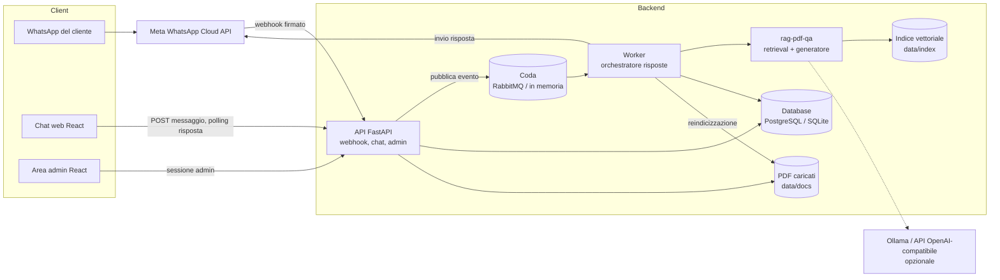
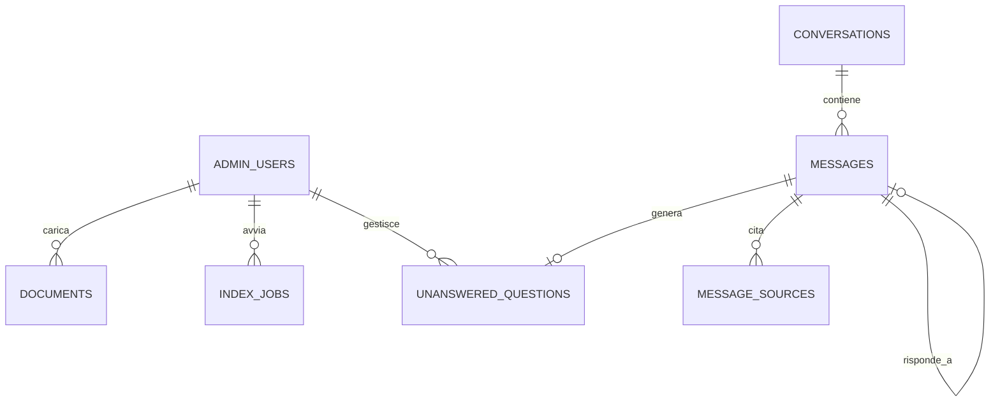

# Specifica tecnica – Assistente NCC su WhatsApp con RAG
Versione: 0.1 | Data: 2026-11-13 | Stato: Bozza completa, da approvare

## 0. Sintesi

Assistente virtuale per un servizio NCC/transfer **fittizio** ("NCC Levante Transfer", Puglia). Risponde su WhatsApp e su una chat web simulata alle domande dei clienti su tariffe, tratte, condizioni e servizi, usando **solo** i documenti PDF dell'attività e citando la fonte. Il titolare gestisce i documenti e controlla conversazioni e domande senza risposta da un'area admin. È un progetto portfolio open source: architettura a eventi (FastAPI, RabbitMQ, worker), RAG riusato dalla libreria `rag-pdf-qa`, frontend React + TypeScript, demo online gratuita.

## 1. Idea

- **Problema:** un piccolo NCC riceve ogni giorno su WhatsApp le stesse domande ("quanto costa Bari aeroporto–Monopoli?", "accettate animali?", "come si disdice?"). Il titolare risponde a mano, spesso mentre guida, con ritardi e risposte non uniformi.
- **Utenti destinatari:** clienti del servizio (privati, turisti, strutture ricettive) e titolare/operatore dell'NCC.
- **Obiettivo di business:** risposte immediate 24/7 e coerenti con i documenti ufficiali; meno messaggi ripetitivi per il titolare; elenco delle domande a cui i documenti non rispondono, per migliorarli.
- **Obiettivo del progetto (portfolio):** mostrare a un recruiter in meno di un minuto un'integrazione AI concreta, con architettura a eventi, test e deployment.
- **Fuori ambito (cosa NON fa):**
  - non prende prenotazioni né incassa pagamenti (richiesta di preventivo prevista in Fase 2);
  - non risponde con conoscenze esterne ai documenti;
  - non invia messaggi promozionali o template WhatsApp a pagamento;
  - non gestisce più attività (multi-tenant);
  - non usa codice, configurazioni o dati di progetti realizzati per altre aziende: è scritto da zero.

## 2. Requisiti

### 2.1 Ruoli utente

| Ruolo | Descrizione | Permessi principali |
| --- | --- | --- |
| Cliente WhatsApp | Scrive al numero WhatsApp Business dell'NCC (solo se le credenziali Meta sono configurate) | Inviare domande, ricevere risposte |
| Visitatore della chat web | Usa la chat simulata nel browser (demo pubblica) | Inviare domande, ricevere risposte con fonti, ricominciare la conversazione |
| Admin | Titolare/operatore dell'NCC | Accesso all'area admin: documenti, reindicizzazione, conversazioni, domande senza risposta |
| Sistema (worker) | Processo che elabora la coda | Leggere/scrivere messaggi, interrogare il motore RAG, inviare risposte |

### 2.2 Requisiti funzionali

| ID | Requisito | Ruolo | Priorità |
| --- | --- | --- | --- |
| RF-01 | Inviare una domanda dalla chat web simulata e ricevere la risposta con le fonti (file e pagina) | Visitatore | MVP |
| RF-02 | Ricevere messaggi di testo WhatsApp tramite webhook Meta e rispondere sullo stesso numero | Cliente WhatsApp | MVP |
| RF-03 | Verificare il webhook Meta (handshake GET con token) e la firma `X-Hub-Signature-256` dei messaggi | Sistema | MVP |
| RF-04 | Elaborare i messaggi in modo asincrono tramite coda, con ritentativi e coda di errore | Sistema | MVP |
| RF-05 | Ignorare i messaggi duplicati (stesso ID messaggio WhatsApp) | Sistema | MVP |
| RF-06 | Rispondere "non lo so" con l'invito a contattare il titolare quando nessun passaggio supera la soglia di similarità, e registrare la domanda come "senza risposta" | Cliente / Visitatore | MVP |
| RF-07 | Rispondere a saluti e "aiuto" con un messaggio di benvenuto ed esempi di domande, senza interrogare il RAG | Cliente / Visitatore | MVP |
| RF-08 | Gestire messaggi non testuali (audio, immagini, posizione) con un messaggio che chiede di scrivere la domanda | Cliente WhatsApp | MVP |
| RF-09 | Login e logout dell'admin | Admin | MVP |
| RF-10 | Caricare documenti PDF (max 10 MB) ed eliminarli | Admin | MVP |
| RF-11 | Avviare la reindicizzazione dei documenti come job asincrono e vederne lo stato | Admin | MVP |
| RF-12 | Consultare l'elenco delle conversazioni e il dettaglio con domande, risposte e fonti | Admin | MVP |
| RF-13 | Consultare le domande senza risposta e segnarle come gestite, con una nota | Admin | MVP |
| RF-14 | Avviare la demo con i documenti NCC fittizi già indicizzati | Sistema | MVP |
| RF-15 | Scegliere il generatore di risposta da configurazione: estrattivo (default in demo), Ollama (locale), API compatibile OpenAI | Sistema | MVP |
| RF-16 | Cancellare automaticamente le conversazioni più vecchie del periodo di conservazione | Sistema | MVP |
| RF-17 | Il cliente può chiedere la cancellazione dei propri messaggi scrivendo "CANCELLA DATI" | Cliente WhatsApp | MVP |
| RF-18 | Dashboard con statistiche: messaggi al giorno, % risposte trovate, domande più frequenti | Admin | Fase 2 |
| RF-19 | Memoria breve della conversazione (ultime 3 domande) per le domande di seguito ("e per 4 persone?") | Cliente / Visitatore | Fase 2 |
| RF-20 | Richiesta di preventivo guidata: tratta, data, ora, passeggeri, bagagli; salvata nell'area admin | Cliente / Visitatore | Fase 2 |
| RF-21 | Risposte in streaming sulla chat web (Server-Sent Events) | Visitatore | Fase 2 |

### 2.3 User story e criteri di accettazione

**RF-01** – Come visitatore voglio fare una domanda nella chat web per sapere subito quanto costa una tratta.
- DATO l'indice con il listino NCC, QUANDO scrivo "Quanto costa il transfer dall'aeroporto di Bari a Monopoli?", ALLORA entro 5 secondi vedo una risposta che contiene la tariffa del listino e la fonte nel formato `[listino_2026.pdf p.1]`.
- DATO che ho inviato un messaggio, QUANDO la risposta è in elaborazione, ALLORA vedo l'indicatore "sta scrivendo…" e il campo di testo resta utilizzabile.

**RF-02** – Come cliente WhatsApp voglio scrivere al numero dell'NCC e ricevere la risposta su WhatsApp.
- DATO un webhook valido con un messaggio di testo, QUANDO arriva a `POST /api/v1/whatsapp/webhook`, ALLORA l'API risponde `200` in meno di 1 secondo e il messaggio viene messo in coda.
- DATO un messaggio in coda, QUANDO il worker lo elabora, ALLORA invia la risposta al mittente tramite Graph API e salva il messaggio in uscita con stato `answered` o `not_found`.

**RF-03** – Come sistema voglio accettare solo chiamate autentiche da Meta.
- DATO un GET con `hub.verify_token` corretto, ALLORA l'API restituisce `hub.challenge`; con token errato restituisce `403`.
- DATO un POST con firma `X-Hub-Signature-256` non valida o assente, ALLORA l'API restituisce `401` e non mette nulla in coda.

**RF-04** – Come sistema voglio che nessun messaggio vada perso se il worker o il LLM falliscono.
- DATO un errore temporaneo (es. Ollama non raggiungibile), QUANDO il worker elabora il messaggio, ALLORA ritenta fino a 3 volte con attesa crescente (2, 4, 8 s).
- DATO il terzo fallimento, ALLORA il messaggio finisce nella coda di errore, lo stato diventa `failed` e il cliente riceve "Al momento non riesco a rispondere, riprova più tardi o contatta il titolare".

**RF-05** – Come sistema voglio evitare risposte doppie.
- DATO un messaggio WhatsApp con `id` già registrato, QUANDO Meta lo reinvia, ALLORA l'API risponde `200` ma non lo rimette in coda.

**RF-06** – Come cliente voglio sapere quando l'assistente non conosce la risposta, invece di ricevere un'informazione inventata.
- DATO una domanda estranea ai documenti ("Chi ha vinto lo scudetto?"), ALLORA la risposta inizia con "Non lo so" e contiene l'invito a contattare il titolare, il generatore non viene chiamato e la domanda compare tra le "senza risposta".

**RF-07** – Come cliente voglio capire cosa posso chiedere.
- DATO il messaggio "ciao" o "aiuto", ALLORA ricevo il benvenuto con 3 esempi di domande, senza interrogazione del RAG.

**RF-08** – Come cliente che invia un audio voglio sapere cosa fare.
- DATO un messaggio di tipo `audio`, `image` o `location`, ALLORA ricevo "Posso rispondere solo a messaggi scritti: scrivimi la tua domanda".

**RF-09** – Come admin voglio accedere all'area riservata in modo sicuro.
- DATO credenziali corrette, ALLORA accedo e ricevo un cookie di sessione `HttpOnly`, `Secure`, `SameSite=Strict`.
- DATO 5 tentativi errati in 15 minuti dallo stesso IP, ALLORA i successivi ricevono `429` per 15 minuti.

**RF-10** – Come admin voglio aggiornare i documenti quando cambiano le tariffe.
- DATO un PDF valido sotto i 10 MB, QUANDO lo carico, ALLORA compare nell'elenco con stato `uploaded`.
- DATO un file non PDF o oltre 10 MB, ALLORA ricevo un errore chiaro (`415` o `413`) e il file non viene salvato.
- DATO un PDF identico a uno già presente (stesso SHA-256), ALLORA ricevo `409` "documento già presente".

**RF-11** – Come admin voglio che il bot usi subito i documenti nuovi.
- QUANDO avvio la reindicizzazione, ALLORA viene creato un job `queued` che passa a `running` e poi `done` (con numero di chunk) o `failed` (con errore); al termine i documenti passano a `indexed`.
- DATO un job già `running`, QUANDO ne avvio un altro, ALLORA ricevo `409`.

**RF-12** – Come admin voglio rileggere le conversazioni per controllare la qualità delle risposte.
- ALLORA vedo le conversazioni ordinate dalla più recente, con canale, contatto pseudonimizzato (es. `***4567`) e numero di messaggi; nel dettaglio vedo ogni risposta con le fonti e il punteggio.

**RF-13** – Come admin voglio sapere cosa manca nei documenti.
- ALLORA vedo le domande senza risposta aperte; QUANDO ne segno una come gestita con una nota, ALLORA sparisce dall'elenco "aperte" e resta consultabile tra le "gestite".

**RF-14** – Come visitatore della demo voglio provare subito il bot.
- DATO il primo avvio con il database vuoto, ALLORA vengono caricati e indicizzati i 3 PDF di esempio in `examples/ncc-docs/` e viene creato l'admin con le credenziali da variabili d'ambiente.

**RF-15** – Come sviluppatore voglio cambiare generatore senza toccare il codice.
- DATO `ANSWER_GENERATOR=extractive|ollama|openai`, ALLORA il worker usa il generatore indicato; con un valore non valido l'avvio fallisce con un messaggio chiaro.

**RF-16** – Come titolare voglio rispettare il GDPR conservando i dati solo il necessario.
- DATO `RETENTION_DAYS=30`, ALLORA un job giornaliero elimina conversazioni, messaggi e fonti più vecchi di 30 giorni.

**RF-17** – Come cliente voglio poter cancellare i miei dati.
- DATO il messaggio "CANCELLA DATI", ALLORA tutti i messaggi della mia conversazione vengono eliminati e ricevo una conferma.

### 2.4 Requisiti non funzionali

| ID | Categoria | Requisito misurabile |
| --- | --- | --- |
| RNF-01 | Prestazioni | Il webhook risponde a Meta in < 1 s (p95), indipendentemente dal tempo del RAG |
| RNF-02 | Prestazioni | Risposta estrattiva end-to-end < 3 s (p95) con 3 documenti; con Ollama `llama3.2` su CPU < 30 s |
| RNF-03 | Affidabilità | Nessun messaggio perso al riavvio del worker (coda durevole, ack manuale dopo il salvataggio della risposta) |
| RNF-04 | Disponibilità | Demo online best effort; se il servizio gratuito è in pausa, il primo avvio richiede al massimo 60 s |
| RNF-05 | Usabilità | Chat utilizzabile da smartphone (larghezza ≥ 360 px) e da desktop |
| RNF-06 | Accessibilità | Frontend conforme a WCAG 2.1 AA: contrasto ≥ 4.5:1, navigazione da tastiera, etichette ARIA, annuncio delle nuove risposte agli screen reader |
| RNF-07 | Normativa (GDPR) | Numeri di telefono salvati solo come hash HMAC-SHA256 più le ultime 4 cifre; conservazione massima 30 giorni (configurabile); informativa privacy nella chat web |
| RNF-08 | Qualità | Copertura dei test backend ≥ 80%; lint senza errori (ruff, ESLint) |
| RNF-09 | Portabilità | Tutto il sistema si avvia in locale con `docker compose up` |
| RNF-10 | Lingua | Interfaccia e risposte in italiano |

## 3. Architettura

- **Stile:** SPA + API, con elaborazione asincrona a eventi (*producer → coda → worker*). Monolite modulare lato backend: un solo codice Python, avviato in due processi (API e worker).



**Moduli e responsabilità**

| Modulo | Responsabilità |
| --- | --- |
| `api/` | Router FastAPI: `chat` (web), `whatsapp` (webhook), `admin` (documenti, job, conversazioni, domande), `auth`, `health` |
| `channels/` | Interfaccia `Channel` con `WhatsAppChannel` (Graph API) e `WebChannel` (salva solo su DB); parsing dei payload Meta |
| `queue/` | Interfaccia `MessageQueue` con `RabbitMQQueue` (aio-pika, coda durevole, DLQ) e `InMemoryQueue` (asyncio, per demo e test) |
| `worker/` | Consumer: deduplica, intent semplici (saluto, aiuto, non testuale, cancella dati), chiamata al RAG, salvataggio, invio, ritentativi |
| `rag/` | Adattatore verso `rag-pdf-qa`: indicizzazione, retrieval, scelta del generatore (estrattivo, Ollama, OpenAI-compatibile) |
| `db/` | Modelli SQLAlchemy 2, sessioni, migrazioni Alembic |
| `services/` | Logica applicativa: conversazioni, documenti, job di indicizzazione, conservazione dati |
| `core/` | Configurazione (pydantic-settings), sicurezza (hash password, firma webhook, HMAC dei numeri), logging |
| `frontend/` | SPA React: chat simulata stile WhatsApp e area admin |

**Stack tecnologico**

| Livello | Tecnologia | Motivo |
| --- | --- | --- |
| Backend API | Python 3.12, FastAPI, Uvicorn | Asincrono, validazione Pydantic, documentazione OpenAPI automatica; già usato in rag-pdf-qa |
| Coda | RabbitMQ 3.13 (aio-pika) | Coda durevole, ack manuale, dead-letter queue; competenza già dimostrata |
| Coda demo/test | `InMemoryQueue` (asyncio) | La demo gratuita gira in un solo processo senza broker |
| RAG | `rag-pdf-qa` (installato da GitHub) | Riuso del proprio progetto: un solo motore, due prodotti |
| Generatore risposte | Estrattivo / Ollama `llama3.2` / API OpenAI-compatibile | Demo gratuita, locale privato, cloud opzionale |
| Database | PostgreSQL 16 (locale), SQLite (demo e test) | Stesso codice via SQLAlchemy; vedi sezione 4 |
| ORM e migrazioni | SQLAlchemy 2, Alembic | Standard Python, migrazioni versionate |
| Frontend | React 19, TypeScript, Vite, React Router, TanStack Query | Stessa base di react-ts-paesi; cache e polling semplici |
| Stile | CSS Modules | Nessuna dipendenza pesante, controllo dell'accessibilità |
| Test | pytest, httpx, pytest-asyncio, Vitest, Testing Library, Playwright | Unit, integrazione ed end-to-end |
| Contenitori | Docker, Docker Compose | Avvio con un comando (RNF-09) |
| CI/CD | GitHub Actions | Già usato in rag-pdf-qa |

**Struttura delle cartelle**

```text
assistente-ncc-rag/
├── backend/
│   ├── app/
│   │   ├── api/            # router: chat, whatsapp, admin, auth, health
│   │   ├── channels/       # whatsapp.py, web.py, payload Meta
│   │   ├── core/           # config.py, security.py, logging.py
│   │   ├── db/             # base.py, session.py, models.py
│   │   ├── queue/          # base.py, rabbitmq.py, memory.py
│   │   ├── rag/            # engine.py (adattatore rag-pdf-qa), generators.py
│   │   ├── services/       # conversations.py, documents.py, indexing.py, retention.py
│   │   ├── worker/         # consumer.py, intents.py
│   │   └── main.py         # crea l'app FastAPI
│   ├── alembic/
│   ├── tests/              # unit/, integration/
│   ├── Dockerfile
│   └── pyproject.toml
├── frontend/
│   ├── src/
│   │   ├── api/            # client HTTP tipizzato
│   │   ├── components/     # ChatWindow, MessageBubble, SourceList, DataTable...
│   │   ├── pages/          # ChatPage, LoginPage, admin/*
│   │   └── main.tsx
│   ├── tests/              # Vitest + Playwright
│   └── Dockerfile
├── examples/ncc-docs/      # listino_2026.pdf, condizioni_servizio.pdf, faq.pdf (fittizi)
├── docs/
│   ├── spec/               # questa specifica
│   └── adr/                # decisioni architetturali
├── docker-compose.yml      # api, worker, rabbitmq, postgres, frontend
├── docker-compose.demo.yml # un solo servizio, SQLite + coda in memoria
├── .env.example
└── .github/workflows/      # ci.yml, deploy.yml
```

**Flusso di un messaggio WhatsApp**

1. Meta invia il webhook → l'API verifica la firma, estrae il messaggio, controlla che l'ID non sia già presente, salva il messaggio in entrata (`received`), pubblica l'evento in coda e risponde `200`.
2. Il worker riceve l'evento → stato `processing` → riconosce gli intent semplici o interroga il RAG.
3. Il worker salva la risposta e le fonti, la invia tramite Graph API e conferma l'evento alla coda (ack). In caso di errore ritenta; dopo 3 tentativi sposta l'evento nella coda di errore.

La chat web segue lo stesso percorso: `POST /api/v1/chat/messages` restituisce `202` con l'ID del messaggio e il frontend interroga `GET /api/v1/chat/conversations/{id}/messages` ogni secondo, per al massimo 60 secondi (streaming con SSE in Fase 2, RF-21).

## 4. Database

- **DBMS:** PostgreSQL 16 in locale e con Docker Compose (tipi UUID e TIMESTAMPTZ, affidabile e gratuito); SQLite per la demo online e per i test, con lo stesso modello SQLAlchemy. Le differenze (UUID salvato come testo, `TIMESTAMPTZ` come testo ISO) sono gestite da SQLAlchemy.
- **Nota:** i vettori del RAG non stanno nel database ma nell'indice FAISS di `rag-pdf-qa` (`data/index`). Il database contiene utenti, documenti, job, conversazioni e messaggi.



**Tabelle**

`admin_users`

| Campo | Tipo | PK/FK | Vincoli | Note |
| --- | --- | --- | --- | --- |
| id | UUID | PK | | |
| email | VARCHAR(254) | | UNIQUE, NOT NULL | salvata in minuscolo |
| password_hash | VARCHAR(255) | | NOT NULL | Argon2id |
| created_at | TIMESTAMPTZ | | NOT NULL, default now() | |
| last_login_at | TIMESTAMPTZ | | NULL | |

`documents`

| Campo | Tipo | PK/FK | Vincoli | Note |
| --- | --- | --- | --- | --- |
| id | UUID | PK | | |
| original_name | VARCHAR(255) | | NOT NULL | nome mostrato all'admin |
| stored_name | VARCHAR(255) | | UNIQUE, NOT NULL | nome generato sul disco, mai quello dell'utente |
| sha256 | CHAR(64) | | UNIQUE, NOT NULL | evita duplicati (RF-10) |
| size_bytes | INTEGER | | NOT NULL, CHECK (size_bytes > 0 AND size_bytes <= 10485760) | 10 MB |
| pages | INTEGER | | NULL, CHECK (pages > 0) | valorizzato all'indicizzazione |
| status | VARCHAR(16) | | NOT NULL, CHECK IN ('uploaded','indexed','error') | |
| uploaded_by | UUID | FK → admin_users.id | ON DELETE SET NULL | |
| uploaded_at | TIMESTAMPTZ | | NOT NULL, default now() | |

`index_jobs`

| Campo | Tipo | PK/FK | Vincoli | Note |
| --- | --- | --- | --- | --- |
| id | UUID | PK | | |
| status | VARCHAR(16) | | NOT NULL, CHECK IN ('queued','running','done','failed') | |
| chunks | INTEGER | | NULL | a job concluso |
| error | TEXT | | NULL | |
| triggered_by | UUID | FK → admin_users.id | ON DELETE SET NULL | NULL per il seed automatico |
| created_at | TIMESTAMPTZ | | NOT NULL, default now() | |
| started_at / finished_at | TIMESTAMPTZ | | NULL | |

`conversations`

| Campo | Tipo | PK/FK | Vincoli | Note |
| --- | --- | --- | --- | --- |
| id | UUID | PK | | per la chat web è anche il token della sessione anonima |
| channel | VARCHAR(16) | | NOT NULL, CHECK IN ('web','whatsapp') | |
| contact_hash | CHAR(64) | | NULL | HMAC-SHA256 del numero WhatsApp (RNF-07); NULL per il web |
| contact_hint | VARCHAR(16) | | NULL | es. `***4567` |
| started_at | TIMESTAMPTZ | | NOT NULL, default now() | |
| last_message_at | TIMESTAMPTZ | | NOT NULL, default now() | usato dalla conservazione dati |

`messages`

| Campo | Tipo | PK/FK | Vincoli | Note |
| --- | --- | --- | --- | --- |
| id | UUID | PK | | |
| conversation_id | UUID | FK → conversations.id | NOT NULL, ON DELETE CASCADE | |
| direction | VARCHAR(8) | | NOT NULL, CHECK IN ('in','out') | |
| external_id | VARCHAR(128) | | UNIQUE, NULL | ID WhatsApp `wamid`, per la deduplica (RF-05) |
| kind | VARCHAR(16) | | NOT NULL, CHECK IN ('text','audio','image','location','other') | |
| body | TEXT | | NOT NULL, CHECK (length(body) <= 4096) | limite WhatsApp |
| status | VARCHAR(16) | | NOT NULL, CHECK IN ('received','processing','answered','not_found','failed','sent') | |
| in_reply_to | UUID | FK → messages.id | NULL, ON DELETE CASCADE | risposta → domanda |
| generator | VARCHAR(16) | | NULL | `extractive`, `ollama`, `openai`, `intent` |
| attempts | SMALLINT | | NOT NULL, default 0 | ritentativi (RF-04) |
| processing_ms | INTEGER | | NULL | per RNF-02 |
| created_at | TIMESTAMPTZ | | NOT NULL, default now() | |

`message_sources`

| Campo | Tipo | PK/FK | Vincoli | Note |
| --- | --- | --- | --- | --- |
| id | BIGINT | PK | identity | |
| message_id | UUID | FK → messages.id | NOT NULL, ON DELETE CASCADE | messaggio in uscita |
| rank | SMALLINT | | NOT NULL, CHECK (rank >= 1), UNIQUE (message_id, rank) | |
| source_file | VARCHAR(255) | | NOT NULL | |
| page | INTEGER | | NOT NULL, CHECK (page >= 1) | |
| score | REAL | | NOT NULL | similarità coseno |
| excerpt | TEXT | | NOT NULL | testo del chunk, per l'admin |

`unanswered_questions`

| Campo | Tipo | PK/FK | Vincoli | Note |
| --- | --- | --- | --- | --- |
| id | UUID | PK | | |
| message_id | UUID | FK → messages.id | UNIQUE, NOT NULL, ON DELETE CASCADE | domanda in entrata senza risposta |
| best_score | REAL | | NULL | punteggio migliore trovato |
| status | VARCHAR(16) | | NOT NULL, default 'open', CHECK IN ('open','handled') | |
| note | VARCHAR(500) | | NULL | |
| handled_by | UUID | FK → admin_users.id | ON DELETE SET NULL | |
| handled_at | TIMESTAMPTZ | | NULL | |

**Indici**

| Tabella | Indice | Motivo |
| --- | --- | --- |
| messages | (conversation_id, created_at) | dettaglio conversazione ordinato (RF-12) |
| messages | UNIQUE (external_id) | deduplica WhatsApp (RF-05) |
| conversations | (channel, contact_hash) | ritrovare la conversazione di un numero |
| conversations | (last_message_at) | elenco admin e conservazione dati (RF-12, RF-16) |
| unanswered_questions | (status, id) | elenco domande aperte (RF-13) |
| index_jobs | (status) | blocco di job concorrenti (RF-11) |

**Normalizzazione:** lo schema è in 3NF. Le fonti stanno in una tabella separata (relazione 1:N con la risposta); lo stato "senza risposta" è un'entità a sé perché ha un ciclo di vita proprio (aperta/gestita, nota, chi l'ha gestita). Unica denormalizzazione motivata: `conversations.last_message_at`, ricavabile da `messages`, salvato per ordinare l'elenco admin e applicare la conservazione senza aggregazioni.

**Schema SQL iniziale (PostgreSQL)**

```sql
CREATE TABLE admin_users (
    id             UUID PRIMARY KEY,
    email          VARCHAR(254) NOT NULL UNIQUE,
    password_hash  VARCHAR(255) NOT NULL,
    created_at     TIMESTAMPTZ  NOT NULL DEFAULT now(),
    last_login_at  TIMESTAMPTZ
);

CREATE TABLE documents (
    id             UUID PRIMARY KEY,
    original_name  VARCHAR(255) NOT NULL,
    stored_name    VARCHAR(255) NOT NULL UNIQUE,
    sha256         CHAR(64)     NOT NULL UNIQUE,
    size_bytes     INTEGER      NOT NULL CHECK (size_bytes > 0 AND size_bytes <= 10485760),
    pages          INTEGER      CHECK (pages > 0),
    status         VARCHAR(16)  NOT NULL CHECK (status IN ('uploaded','indexed','error')),
    uploaded_by    UUID REFERENCES admin_users(id) ON DELETE SET NULL,
    uploaded_at    TIMESTAMPTZ  NOT NULL DEFAULT now()
);

CREATE TABLE index_jobs (
    id            UUID PRIMARY KEY,
    status        VARCHAR(16) NOT NULL CHECK (status IN ('queued','running','done','failed')),
    chunks        INTEGER,
    error         TEXT,
    triggered_by  UUID REFERENCES admin_users(id) ON DELETE SET NULL,
    created_at    TIMESTAMPTZ NOT NULL DEFAULT now(),
    started_at    TIMESTAMPTZ,
    finished_at   TIMESTAMPTZ
);
CREATE INDEX ix_index_jobs_status ON index_jobs (status);

CREATE TABLE conversations (
    id               UUID PRIMARY KEY,
    channel          VARCHAR(16) NOT NULL CHECK (channel IN ('web','whatsapp')),
    contact_hash     CHAR(64),
    contact_hint     VARCHAR(16),
    started_at       TIMESTAMPTZ NOT NULL DEFAULT now(),
    last_message_at  TIMESTAMPTZ NOT NULL DEFAULT now()
);
CREATE INDEX ix_conversations_contact ON conversations (channel, contact_hash);
CREATE INDEX ix_conversations_last_message ON conversations (last_message_at);

CREATE TABLE messages (
    id               UUID PRIMARY KEY,
    conversation_id  UUID NOT NULL REFERENCES conversations(id) ON DELETE CASCADE,
    direction        VARCHAR(8)  NOT NULL CHECK (direction IN ('in','out')),
    external_id      VARCHAR(128) UNIQUE,
    kind             VARCHAR(16) NOT NULL CHECK (kind IN ('text','audio','image','location','other')),
    body             TEXT NOT NULL CHECK (length(body) <= 4096),
    status           VARCHAR(16) NOT NULL
                     CHECK (status IN ('received','processing','answered','not_found','failed','sent')),
    in_reply_to      UUID REFERENCES messages(id) ON DELETE CASCADE,
    generator        VARCHAR(16),
    attempts         SMALLINT NOT NULL DEFAULT 0,
    processing_ms    INTEGER,
    created_at       TIMESTAMPTZ NOT NULL DEFAULT now()
);
CREATE INDEX ix_messages_conversation ON messages (conversation_id, created_at);

CREATE TABLE message_sources (
    id           BIGINT GENERATED ALWAYS AS IDENTITY PRIMARY KEY,
    message_id   UUID NOT NULL REFERENCES messages(id) ON DELETE CASCADE,
    rank         SMALLINT NOT NULL CHECK (rank >= 1),
    source_file  VARCHAR(255) NOT NULL,
    page         INTEGER NOT NULL CHECK (page >= 1),
    score        REAL NOT NULL,
    excerpt      TEXT NOT NULL,
    UNIQUE (message_id, rank)
);

CREATE TABLE unanswered_questions (
    id          UUID PRIMARY KEY,
    message_id  UUID NOT NULL UNIQUE REFERENCES messages(id) ON DELETE CASCADE,
    best_score  REAL,
    status      VARCHAR(16) NOT NULL DEFAULT 'open' CHECK (status IN ('open','handled')),
    note        VARCHAR(500),
    handled_by  UUID REFERENCES admin_users(id) ON DELETE SET NULL,
    handled_at  TIMESTAMPTZ
);
CREATE INDEX ix_unanswered_status ON unanswered_questions (status, id);
```

**Migrazioni e backup**

- Le migrazioni sono gestite con Alembic: ogni modifica allo schema è uno script versionato in `backend/alembic/versions`, applicato all'avvio del container (`alembic upgrade head`).
- In locale il volume Docker di PostgreSQL contiene i dati; il backup si fa con `pg_dump` tramite uno script `scripts/backup.sh`.
- Nella demo online il database SQLite è effimero e viene ricreato con i dati di esempio a ogni avvio (RF-14): non contiene dati reali.
- I PDF caricati (`data/docs`) e l'indice (`data/index`) stanno su un volume; l'indice si può sempre ricostruire dai PDF con la reindicizzazione.

## 5. UI/UX

**Mappa delle schermate**

| Percorso | Schermata | Ruolo | Requisiti |
| --- | --- | --- | --- |
| `/` | Chat simulata stile WhatsApp | Visitatore | RF-01, RF-06, RF-07, RF-14 |
| `/privacy` | Informativa privacy | Tutti | RNF-07 |
| `/admin/login` | Accesso admin | Admin | RF-09 |
| `/admin/documenti` | Documenti e indicizzazione | Admin | RF-10, RF-11 |
| `/admin/conversazioni` | Elenco conversazioni | Admin | RF-12 |
| `/admin/conversazioni/:id` | Dettaglio conversazione con fonti | Admin | RF-12 |
| `/admin/domande` | Domande senza risposta | Admin | RF-13 |

**Schermate**

| Schermata | Scopo | Componenti | Azioni |
| --- | --- | --- | --- |
| Chat simulata | Provare l'assistente come su WhatsApp | Intestazione con nome dell'NCC e badge "Demo"; area messaggi con bolle (cliente a destra, assistente a sinistra); sotto ogni risposta le fonti come chip `listino_2026.pdf p.1` espandibili con l'estratto; 3 domande di esempio cliccabili; campo di testo (max 1000 caratteri) e pulsante Invia; link all'informativa | Inviare, cliccare un esempio, espandere una fonte, "Nuova conversazione" |
| Login admin | Accesso riservato | Email, password, pulsante Accedi, messaggio di errore generico | Accedere |
| Documenti | Gestire la base di conoscenza | Tabella (nome, pagine, dimensione, stato, data); area di caricamento con trascinamento; pulsante "Reindicizza" con stato dell'ultimo job | Caricare, eliminare (con conferma), reindicizzare |
| Conversazioni | Controllare la qualità | Tabella paginata (canale, contatto `***4567`, numero di messaggi, ultima attività); filtro per canale | Aprire il dettaglio |
| Dettaglio conversazione | Rileggere le risposte | Cronologia dei messaggi; per ogni risposta generatore, tempo di elaborazione, fonti con punteggio ed estratto | Tornare all'elenco |
| Domande senza risposta | Migliorare i documenti | Schede "Aperte" e "Gestite"; tabella con domanda, data, miglior punteggio | Segnare come gestita con nota |

**Flussi principali**

1. **Visitatore:** apre `/` → clicca un esempio o scrive → vede "sta scrivendo…" → legge la risposta → espande la fonte per verificare.
2. **Admin, aggiornamento listino:** login → Documenti → carica il nuovo PDF → elimina il vecchio → Reindicizza → stato `done` → prova la domanda nella chat.
3. **Admin, miglioramento:** Domande senza risposta → legge "Accettate cani?" → aggiunge l'informazione nelle condizioni → ricarica il PDF → reindicizza → segna la domanda come gestita.

**Responsive, accessibilità e stati**

- Breakpoint: mobile < 640 px (chat a tutto schermo, menu admin a scomparsa), tablet 640–1024 px, desktop > 1024 px (menu admin laterale).
- WCAG 2.1 AA: contrasto ≥ 4.5:1, focus visibile, ogni campo con etichetta, area messaggi con `aria-live="polite"`, tabelle con intestazioni `<th scope>`, pulsanti raggiungibili da tastiera, conferme di eliminazione in un `<dialog>` accessibile.
- Stati: caricamento (scheletri e "sta scrivendo…"), vuoto ("Nessuna domanda senza risposta 🎉", "Carica il primo documento"), errore (messaggio chiaro e "Riprova"), tempo scaduto dopo 60 s ("La risposta sta richiedendo più tempo del previsto").

## 6. API

- **Stile:** REST, JSON, prefisso `/api/v1`. Documentazione OpenAPI automatica su `/docs`, disattivabile in produzione.
- **Autenticazione:** chat web anonima tramite l'ID della conversazione (UUID v4 casuale, conservato in `sessionStorage`); area admin con cookie di sessione (sezione 7); webhook con firma Meta.

| Metodo | Percorso | Descrizione | Ruolo | Body | Risposta | Codici errore |
| --- | --- | --- | --- | --- | --- | --- |
| GET | `/api/v1/health` | Stato di API, database, coda e indice | Pubblico | – | `200 {status, db, queue, index}` | `503` |
| POST | `/api/v1/chat/conversations` | Crea una conversazione web | Visitatore | – | `201 {id}` | `429` |
| POST | `/api/v1/chat/conversations/{id}/messages` | Invia una domanda | Visitatore | `{text}` (1–1000 car.) | `202 {message_id}` | `404`, `422`, `429` |
| GET | `/api/v1/chat/conversations/{id}/messages?after={message_id}` | Messaggi successivi a un ID (polling) | Visitatore | – | `200 {items:[{id, direction, body, status, sources[], created_at}]}` | `404` |
| GET | `/api/v1/whatsapp/webhook` | Verifica del webhook Meta | Meta | query `hub.mode`, `hub.verify_token`, `hub.challenge` | `200` testo challenge | `403` |
| POST | `/api/v1/whatsapp/webhook` | Riceve i messaggi WhatsApp | Meta | payload Meta | `200` | `401` firma non valida |
| POST | `/api/v1/auth/login` | Accesso admin | Pubblico | `{email, password}` | `204` + cookie | `401`, `429` |
| POST | `/api/v1/auth/logout` | Uscita | Admin | – | `204` | `401` |
| GET | `/api/v1/auth/me` | Admin corrente | Admin | – | `200 {email}` | `401` |
| GET | `/api/v1/admin/documents` | Elenco documenti | Admin | – | `200 {items[]}` | `401` |
| POST | `/api/v1/admin/documents` | Carica un PDF | Admin | multipart `file` | `201 {document}` | `409`, `413`, `415` |
| DELETE | `/api/v1/admin/documents/{id}` | Elimina un documento | Admin | – | `204` | `404` |
| POST | `/api/v1/admin/index-jobs` | Avvia la reindicizzazione | Admin | – | `202 {job}` | `409` |
| GET | `/api/v1/admin/index-jobs?limit=5` | Ultimi job | Admin | – | `200 {items[]}` | `401` |
| GET | `/api/v1/admin/index-jobs/{id}` | Stato di un job | Admin | – | `200 {job}` | `404` |
| GET | `/api/v1/admin/conversations?channel=&page=&size=` | Elenco conversazioni | Admin | – | `200 {items, total, page, size}` | `422` |
| GET | `/api/v1/admin/conversations/{id}` | Dettaglio con messaggi e fonti | Admin | – | `200 {conversation, messages[]}` | `404` |
| GET | `/api/v1/admin/unanswered?status=open&page=&size=` | Domande senza risposta | Admin | – | `200 {items, total, page, size}` | `422` |
| PATCH | `/api/v1/admin/unanswered/{id}` | Segna come gestita | Admin | `{status:"handled", note}` | `200 {item}` | `404`, `422` |

Le richieste admin che modificano dati (POST, PATCH, DELETE) richiedono anche l'intestazione `X-CSRF-Token` (sezione 7).

**Formato errori standard**

```json
{ "error": { "code": "document_duplicate", "message": "Documento già presente.", "details": null } }
```

- **Paginazione:** `page` (da 1) e `size` (default 20, max 100); risposta `{items, total, page, size}`. Ordinamento fisso dal più recente; filtri: `channel`, `status`.
- **Integrazioni esterne:**
  - **Meta WhatsApp Cloud API:** in entrata webhook; in uscita `POST https://graph.facebook.com/v{versione}/{PHONE_NUMBER_ID}/messages` con token Bearer, solo messaggi di testo entro la finestra di 24 ore aperta dal cliente (nessun template a pagamento).
  - **Ollama:** `POST {OLLAMA_URL}/api/chat` (tramite rag-pdf-qa).
  - **API compatibile OpenAI:** `POST {OPENAI_BASE_URL}/chat/completions` (tramite rag-pdf-qa), opzionale.

## 7. Sicurezza

- **Autenticazione admin:** email e password; JWT firmato (HS256, chiave `SECRET_KEY`) in cookie `HttpOnly`, `Secure`, `SameSite=Strict`, durata 8 ore, nessun rinnovo silenzioso. MFA fuori dall'MVP: con un solo admin si compensa con limite di tentativi e password robusta (min. 12 caratteri). [IPOTESI] TOTP in Fase 2.
- **Autorizzazione (RBAC):**

| Risorsa / azione | Visitatore | Cliente WhatsApp | Admin | Worker |
| --- | --- | --- | --- | --- |
| Inviare e leggere messaggi della propria conversazione | ✅ | ✅ (via WhatsApp) | – | – |
| Leggere tutte le conversazioni | ❌ | ❌ | ✅ | ✅ |
| Caricare, eliminare documenti | ❌ | ❌ | ✅ | – |
| Avviare la reindicizzazione | ❌ | ❌ | ✅ | esegue |
| Gestire le domande senza risposta | ❌ | ❌ | ✅ | crea |
| Cancellare i propri dati | – | ✅ ("CANCELLA DATI") | ✅ (tramite conservazione) | esegue |

- **Password:** hash Argon2id (argon2-cffi, parametri di default della libreria). Admin creato all'avvio da `ADMIN_EMAIL` / `ADMIN_PASSWORD`; reset tramite comando da terminale (`python -m app.cli reset-admin-password`), nessun reset via email nell'MVP.
- **Validazione input:** modelli Pydantic con lunghezze massime (domanda 1000 caratteri, nota 500); query solo tramite SQLAlchemy con parametri (niente SQL concatenato → no SQL injection); React esegue l'escape del testo e non si usa `dangerouslySetInnerHTML` (→ no XSS); intestazione `Content-Security-Policy: default-src 'self'`.
- **CSRF:** cookie `SameSite=Strict` più token double-submit: al login il server imposta un cookie `csrf_token` leggibile dal frontend, che lo rimanda in `X-CSRF-Token`.
- **Upload sicuro:** solo `application/pdf` con firma `%PDF-` nei primi byte, massimo 10 MB, nome sul disco generato (UUID), cartella fuori dalla radice servita, apertura con pypdf nel worker con gestione degli errori.
- **Webhook:** firma HMAC-SHA256 del corpo con `META_APP_SECRET`, confronto a tempo costante; token di verifica `META_VERIFY_TOKEN`.
- **Protezione API:** rate limiting (slowapi): chat 10 messaggi/minuto e 100/giorno per IP; login 5 tentativi/15 minuti per IP. CORS consentito solo all'origine del frontend (`FRONTEND_ORIGIN`).
- **Prompt injection:** il testo dei PDF e delle domande è trattato come dato; rag-pdf-qa racchiude il contesto tra delimitatori e il prompt di sistema impone di usare solo il contesto. Solo l'admin può caricare documenti.
- **Gestione segreti:** solo variabili d'ambiente (`.env` escluso da Git, `.env.example` con valori finti), GitHub Secrets per la CI, variabili d'ambiente dell'hosting per la demo. Nessun segreto nei log.
- **Dati personali (GDPR):** minimizzazione (numero salvato come HMAC con `CONTACT_HASH_KEY` più ultime 4 cifre; nessun nome); conservazione massima `RETENTION_DAYS` (30); cancellazione su richiesta ("CANCELLA DATI"); informativa nella chat web; log applicativi senza il testo dei messaggi. Nella demo pubblica un avviso chiede di non inserire dati personali.
- **Log di audit:** login (riusciti e falliti), caricamento ed eliminazione documenti, reindicizzazioni, domande gestite: registrati nei log strutturati con ID admin, IP e data.
- **Dipendenze:** `pip-audit` e `npm audit` in CI; Dependabot settimanale; immagini Docker basate su `python:3.12-slim` e `node:22-alpine`, utente non root.

## 8. Test

- **Strategia:**
  - **unit:** intent, parsing dei payload Meta, firma webhook, HMAC dei contatti, generatori, servizi;
  - **integrazione:** API con database SQLite e `InMemoryQueue`; worker con RabbitMQ reale in CI (container di servizio); client WhatsApp con risposte HTTP simulate (respx);
  - **end-to-end:** Playwright sulla demo avviata con `docker-compose.demo.yml` (chat e area admin).
- **Strumenti:** pytest, pytest-asyncio, httpx, respx, coverage; Vitest e Testing Library per i componenti React; Playwright per l'end-to-end.

| Requisito | Test principali |
| --- | --- |
| RF-01 | Integrazione: domanda sul listino → risposta con tariffa e fonte `listino_2026.pdf`; E2E: invio dalla chat e fonte visibile |
| RF-02 | Integrazione: payload Meta valido → `200`, evento in coda; worker → chiamata Graph API simulata con il testo atteso |
| RF-03 | Unit: firma valida/non valida/assente; integrazione: handshake GET con token giusto e sbagliato |
| RF-04 | Integrazione: generatore che fallisce 2 volte → successo al terzo tentativo; fallisce sempre → stato `failed`, coda di errore, messaggio di scuse |
| RF-05 | Integrazione: stesso `wamid` inviato due volte → un solo evento in coda |
| RF-06 | Integrazione: domanda fuori tema → "Non lo so", generatore non chiamato, riga in `unanswered_questions` |
| RF-07, RF-08 | Unit: riconoscimento di saluti, "aiuto" e tipi non testuali |
| RF-09 | Integrazione: login corretto (cookie con flag), errato (`401`), sesto tentativo (`429`); E2E: login e logout |
| RF-10 | Integrazione: PDF valido (`201`), file non PDF (`415`), oltre 10 MB (`413`), duplicato (`409`) |
| RF-11 | Integrazione: job `queued → running → done`; secondo job durante il primo → `409` |
| RF-12 | Integrazione: elenco paginato e dettaglio con fonti; utente non autenticato → `401` |
| RF-13 | Integrazione: PATCH a `handled` con nota; E2E: la domanda passa da "Aperte" a "Gestite" |
| RF-14 | Integrazione: avvio con database vuoto → 3 documenti indicizzati e admin creato |
| RF-15 | Unit: factory dei generatori, valore non valido → errore di configurazione |
| RF-16, RF-17 | Integrazione: conversazioni più vecchie di 30 giorni eliminate; "CANCELLA DATI" elimina i messaggi e conferma |
| RNF-01, RNF-02 | Test di prestazione semplice: 50 webhook consecutivi, p95 < 1 s; tempo di risposta estrattiva registrato in `processing_ms` |
| RNF-06 | Playwright con axe-core: nessuna violazione WCAG AA sulle schermate principali |

- **Soglia di copertura:** backend ≥ 80% (il CI fallisce sotto soglia); componenti React principali coperti da Vitest.

## 9. Deployment

| Ambiente | Dove | Configurazione |
| --- | --- | --- |
| Sviluppo | PC locale | `docker compose up`: api, worker, rabbitmq, postgres, frontend (Vite); Ollama sull'host; embedding semantici (sentence-transformers) |
| CI | GitHub Actions | Container di servizio PostgreSQL e RabbitMQ; SQLite per i test veloci |
| Demo pubblica | [IPOTESI] Render, piano gratuito (alternative: Koyeb, Fly.io) | `docker-compose.demo.yml` → un solo container: FastAPI serve anche il frontend compilato; SQLite; `InMemoryQueue` con worker nello stesso processo; embedding TF-IDF e generatore estrattivo (rientrano nei 512 MB di RAM del piano gratuito) |
| Produzione reale | Fuori dall'ambito del portfolio; [IPOTESI] VPS con Docker Compose, Nginx e Certbot | Come lo sviluppo, con HTTPS e backup automatici |

- **HTTPS:** fornito dall'hosting della demo (certificato automatico). Il webhook Meta richiede HTTPS pubblico: per i test locali con un numero reale si usa un tunnel (es. Cloudflare Tunnel o ngrok).
- **CI/CD (GitHub Actions):**
  - `ci.yml`, a ogni push e pull request: ruff e mypy, pytest con copertura, ESLint, Vitest, build del frontend, `pip-audit` e `npm audit`, build dell'immagine Docker; Playwright sulla demo in container.
  - `deploy.yml`, al push su `main` con CI verde: pubblica l'immagine su GitHub Container Registry (tag = SHA del commit) e chiama il deploy hook dell'hosting.
- **Variabili d'ambiente (solo nomi):** `APP_ENV`, `SECRET_KEY`, `DATABASE_URL`, `QUEUE_BACKEND`, `RABBITMQ_URL`, `FRONTEND_ORIGIN`, `ADMIN_EMAIL`, `ADMIN_PASSWORD`, `CONTACT_HASH_KEY`, `RETENTION_DAYS`, `ANSWER_GENERATOR`, `RAG_EMBEDDER`, `RAG_INDEX_DIR`, `DOCS_DIR`, `OLLAMA_URL`, `OLLAMA_MODEL`, `OPENAI_BASE_URL`, `OPENAI_MODEL`, `OPENAI_API_KEY`, `WHATSAPP_ENABLED`, `META_ACCESS_TOKEN`, `META_PHONE_NUMBER_ID`, `META_APP_SECRET`, `META_VERIFY_TOKEN`, `META_GRAPH_VERSION`.
- **Monitoraggio e log:** endpoint `/api/v1/health` controllato dall'hosting; log strutturati JSON (livello, evento, ID richiesta, durata) senza dati personali; metriche essenziali calcolate dal database (messaggi, % risposte trovate, tempi).
- **Backup e ripristino:** in locale `pg_dump` giornaliero tramite script e copia del volume `data/docs`; l'indice si ricostruisce dai PDF. La demo non ha backup perché si ricrea a ogni avvio.
- **Rollback:** ogni deploy usa un'immagine con tag immutabile; per tornare indietro si ridistribuisce il tag precedente dal pannello dell'hosting o rilanciando `deploy.yml` sul commit precedente. Le migrazioni Alembic hanno sempre il `downgrade`.

## 10. Piano di rilascio

| Fase | Contenuto | Requisiti inclusi | Criterio di completamento |
| --- | --- | --- | --- |
| F0 – Fondamenta (1 giorno) | Repository, struttura cartelle, configurazione, Docker Compose, modelli e prima migrazione, PDF di esempio NCC | – | `docker compose up` avvia api, worker, db, coda; `/health` verde |
| F1 – Chat web con RAG (3 giorni) | Adattatore rag-pdf-qa, worker, `InMemoryQueue`, intent, chat React | RF-01, RF-06, RF-07, RF-14, RF-15 | Domande sul listino con fonte; "Non lo so" fuori tema; test verdi |
| F2 – WhatsApp e coda affidabile (3 giorni) | Webhook con firma, deduplica, `RabbitMQQueue` con ritentativi e coda di errore, invio Graph API | RF-02, RF-03, RF-04, RF-05, RF-08 | Test di integrazione verdi; prova con numero di test Meta, se disponibile |
| F3 – Area admin (3 giorni) | Login, documenti, job di indicizzazione, conversazioni, domande senza risposta | RF-09, RF-10, RF-11, RF-12, RF-13 | Flussi admin 2 e 3 della sezione 5 eseguibili end-to-end |
| F4 – GDPR e rifinitura (1–2 giorni) | Conservazione dati, "CANCELLA DATI", rate limiting, CSP, accessibilità, README con GIF | RF-16, RF-17, RNF-06, RNF-07 | Checklist di sicurezza completa; nessuna violazione axe |
| **MVP completo** | | RF-01 → RF-17 | Copertura ≥ 80%, README e diagramma pubblicati |
| F5 – CI/CD e demo online (3–5 giorni) | `ci.yml`, `deploy.yml`, immagine su GHCR, demo pubblica | RNF-04, RNF-08, RNF-09 | Badge CI verde; link della demo funzionante nel README |
| Fase 2 | Statistiche, memoria breve, richiesta di preventivo, streaming SSE, TOTP | RF-18 → RF-21 | Da pianificare dopo l'MVP |

## 11. Questioni aperte e rischi

| # | Questione / rischio | Impatto | Decisione richiesta a |
| --- | --- | --- | --- |
| 1 | Per provare WhatsApp reale serve un account Meta for Developers con numero di test e un indirizzo HTTPS pubblico (tunnel). Senza, il progetto funziona comunque con la chat simulata | Medio: F2 si verifica solo con i test simulati | Titolare del progetto |
| 2 | Hosting della demo: Render gratuito va in pausa dopo 15 minuti di inattività (primo avvio lento, RNF-04) | Basso | Titolare del progetto, in F5 |
| 3 | Sul piano gratuito gli embedding semantici (circa 470 MB più PyTorch) non entrano nella RAM: la demo usa TF-IDF e risposte estrattive, meno precise sui sinonimi | Medio: qualità della demo inferiore alla versione locale | Deciso; da spiegare nel README |
| 4 | rag-pdf-qa ha `ingest` e `ask` ma non espone ancora un'API comoda per reindicizzare da una lista di file e restituire le fonti con l'estratto: possibili piccole modifiche alla libreria | Basso | Da verificare in F1 |
| 5 | Reindicizzazione mentre arrivano domande: il nuovo indice va costruito in una cartella temporanea e sostituito con un rename atomico, per non rispondere con un indice a metà | Medio | Deciso (implementazione in F3) |
| 6 | Il nome "NCC Levante Transfer" potrebbe appartenere a un'azienda reale | Basso, ma da evitare | [IPOTESI] da verificare con una ricerca prima della pubblicazione |
| 7 | La chat demo è pubblica: possibili abusi o messaggi inappropriati | Basso | Mitigato con rate limiting, nessun LLM generativo online e avviso di non inserire dati personali |
| 8 | Risposte estrattive meno naturali di un LLM | Basso | Accettato: è un compromesso dichiarato; in locale si usa Ollama |
